# Optimisations de Nyx GPU Instancing

Journal des optimisations du package : ce qui a été changé, pourquoi, et ce que ça change, mesures et images avant / après.

**Machine de mesure :** i7-6700K (8 threads), GeForce GTX 1060 6 Go, Direct3D 11, Unity 2021.3.40f1, pipeline Built-in, 1280 × 720. Mesures des 5 et 6 novembre 2026.

**Deux lieux de mesure :**
- **Éditeur** : rendu forcé d'une caméra puis attente de la fin du GPU, médiane de 40 à 300 images. Les temps comprennent un peu d'attente de synchronisation : comparer les colonnes entre elles, pas avec une build.
- **Build de développement** : temps par image du jeu, VSync coupée.

## Résumé

| Optimisation | Ce qui change | Gain mesuré | Contrepartie |
|---|---|---|---|
| [Construction sur GPU](#1-construction-des-instances-sur-gpu) | placement, filtrage par la zone, instances et bulles calculés par compute shader | reconstruction de 1 000 000 de rochers : 45 → 1,3 ms (thread principal) | une reconstruction attend quelques compteurs du GPU |
| [Envoi des instances écrites en C#](#2-envoi-des-instances-écrites-en-c) | `SetData` au lieu d'un buffer intermédiaire copié par le GPU | 146 → 86 ms pour 1 000 000 d'instances | aucune |
| [Pics du Profiler](#3-pics-dans-le-profiler-de-léditeur) | diagnostic : la fenêtre Profiler se redessine | aucun pic du jeu en build | aucune |
| [Graine interpolée](#41-graine-de-linstance-par-interpolateur) | shader des sargasses : graine lue par sommet et non par pixel | −0,4 ms en médiane (de 0 à −0,8 selon la mesure) ; images lentes 14,1 → 12,6 ms | aucune |
| [Hors de la passe de profondeur](#42-exclude-from-depth-texture) | option du Mesh Spawner : les sargasses sortent de la texture de profondeur | build : 8,05 → 5,57 ms (124 → 176 images/s) | plus d'ombres reçues par les instances |
| [Zone naturelle](#5-zones-naturelles) | contour courbe, bord irrégulier, lisière, calculés sur GPU | 0,75 ms pour 1 000 000 de tests, contre 8,2 ms pour un contour de 1 024 sommets | 64 points de contrôle maximum |

## 1. Construction des instances sur GPU

**Avant :** le placement (grille, amas, liste), le filtrage par la zone et les données d'instance étaient calculés sur le CPU par des jobs Burst, puis envoyés au GPU (64 octets par instance).

**Après :** tout est calculé par `InstanceBuild.compute`, directement dans le buffer d'instances. Les colonnes de bulles sont construites par un noyau de `BubbleColumns.compute`. Le CPU ne prépare que quelques paramètres et ne lit que des compteurs (total, nombre par variante, boîte des positions) pour dimensionner les buffers.
- Le tirage aléatoire de `Unity.Mathematics.Random` est porté à l'identique. Comparé à l'ancien calcul : mêmes nombres d'instances, mêmes variantes, mêmes graines ; positions à un arrondi de flottant près (0,5 mm à 5 km de l'origine). Les scènes existantes gardent leur placement.
- Mémoire CPU retenue entre deux reconstructions : 28 o par instance → 0.

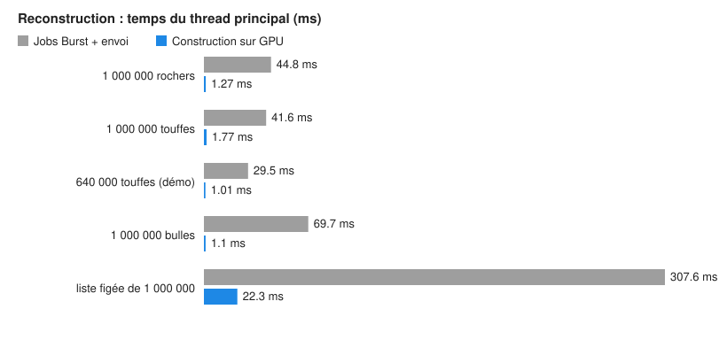

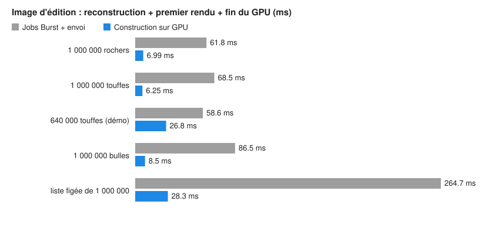

L'« image d'édition » est ce que ressent un level designer qui déplace un spawner : reconstruction, premier rendu et fin du GPU. Pour les 640 000 touffes de la démo, elle reste à 27 ms : c'est le rendu, pas la construction (voir section 4).

## 2. Envoi des instances écrites en C#

Seul un comportement qui écrit ses instances en C# (surcharge de `CreateInstance(s)` ou `BuildInstances`) envoie encore des instances depuis le CPU.

Une première version écrivait les instances dans un buffer intermédiaire (`ComputeBufferMode.SubUpdates`) par un job parallèle, puis un compute shader les copiait. Mesuré jusqu'à la fin du GPU, c'est plus lent que `SetData` : la copie lit la mémoire visible du CPU à travers le bus. Ce chemin a été retiré.

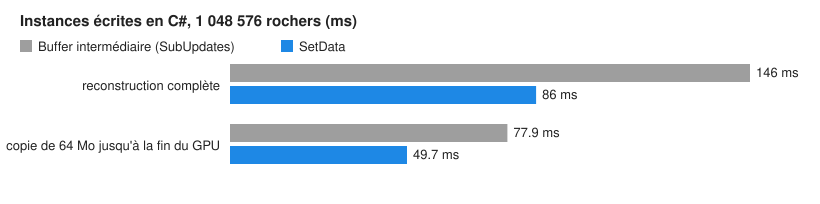

| 1 048 576 instances | Buffer intermédiaire | `SetData` |
|---|---|---|
| Reconstruction complète, chemin C# | 126 à 151 ms | 80 à 90 ms |
| Copie de 64 Mo, jusqu'à la fin du GPU | 74 à 96 ms | 48 à 50 ms |

## 3. Pics dans le Profiler de l'éditeur

**Symptôme :** dans le Profiler, en Play mode dans l'éditeur, 11 pics de 17 à 56 ms sur 300 images, à intervalles irréguliers (1 à 79 images), pour une médiane de 6,2 ms.

**Cause :** ils sont dans `EditorLoop`, le travail de l'éditeur autour du jeu. Le jeu lui-même (`PlayerLoop`) reste entre 1 et 4 ms pendant ces pics, les Mesh Spawners à 0,25 ms. En profilant l'éditeur entier, chaque pic contient `ProfilerWindow.Paint` ≈ 37 ms : la fenêtre Profiler qui redessine ses graphes.

**En build de développement :** aucun pic du jeu. La première mesure en donne 0 sur 2 617 images. La seconde, faite avec l'éditeur ouvert à côté, en donne une seule isolée par phase de 20 s (18 et 28 ms).

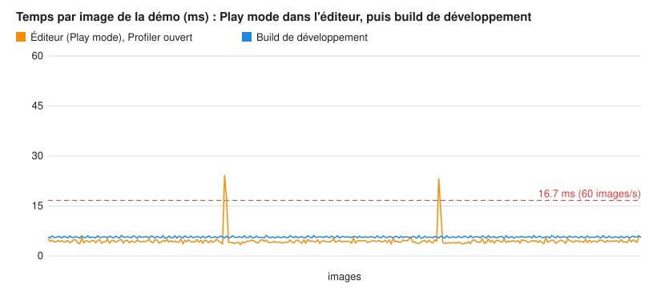

Pour mesurer le jeu sans ce biais : le Profiler en processus séparé (Window > Analysis > Profiler (Standalone Process)), ou une build de développement.

## 4. Rendu des sargasses

Scène de démo (valeurs de test de charge) : environ 930 000 touffes, dont 440 000 visibles depuis la caméra principale, 3,6 M de triangles par passe, ombres du soleil actives.

Répartition du temps GPU d'une image :

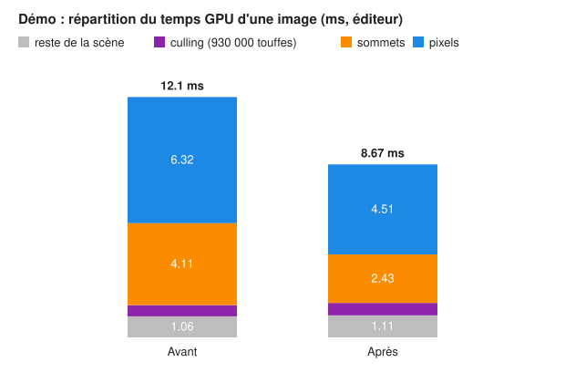

| Poste (éditeur) | Avant | Après |
|---|---|---|
| Pixels (frondes alpha-testées, double face) | 6,32 ms | 4,51 ms |
| Sommets (petites touffes : passe de profondeur + image) | 4,11 ms | 2,43 ms |
| Culling des 930 000 touffes | 0,56 ms | 0,62 ms |
| Reste de la scène | 1,06 ms | 1,11 ms |
| **Image** | **12,05 ms** | **8,67 ms** |

Temps GPU image par image dans l'éditeur. Les trois états sont mesurés en alternance, par blocs de 50 images, pour que la dérive des horloges les touche de la même façon :

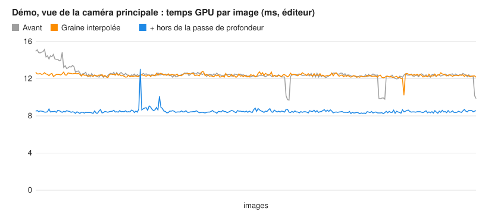

| État (éditeur, 300 images) | Médiane | 95 % |
|---|---|---|
| Avant | 12,41 ms | 14,13 ms |
| Graine interpolée | 12,37 ms | 12,60 ms |
| + hors de la passe de profondeur | 8,45 ms | 8,73 ms |

### 4.1 Graine de l'instance par interpolateur

**Avant :** le pixel shader des sargasses relisait la graine de l'instance (teinte) dans le buffer des instances visibles à chaque pixel, soit deux lectures dépendantes.

**Après :** elle est lue une fois par sommet et passée au pixel shader par un interpolateur.

**Gain :** faible.
- −0,4 à −0,8 ms en mesures alternées ;
- 0 sur la médiane de la série ci-dessus, mais les images lentes passent de 14,1 à 12,6 ms (95e centile) ;
- aucune différence à l'image.

### 4.2 Exclude From Depth Texture

**Cause :** dès que le soleil projette des ombres, Unity (pipeline Built-in) redessine toute la scène opaque dans une texture de profondeur avant l'image, pour les ombres en espace écran. Pour un grand champ de végétation alpha-testée, cette passe coûte presque autant que l'image.

Décocher *Receive Shadows* ne suffit pas : −0,4 ms seulement, la passe dessine toujours les instances. Désactiver la passe `ShadowCaster` du matériau ne sort pas non plus un draw indirect de cette passe. Seule une file de rendu au-dessus de 2500 le fait.

**Option du Mesh Spawner :** le spawner dessine avec des copies de ses matériaux dont la file de rendu passe à 2501. Les assets ne sont pas modifiés, et les copies suivent les réglages des originaux.

**Contrepartie :**
- les instances ne reçoivent plus d'ombres (d'un bateau, par exemple) ;
- les effets qui lisent la profondeur ne les voient plus : profondeur de champ, SSAO, eau qui lit la profondeur ;
- elles projettent toujours leur ombre si *Cast Shadows* est actif.

Option cochée sur les sargasses de la scène de démo.

Build de développement, même exécution, option basculée au milieu :

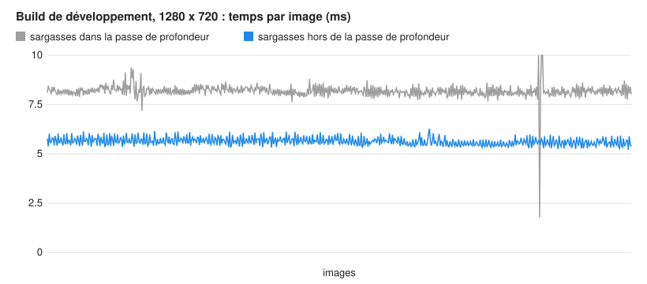

| Build de développement, 20 s chacune | Médiane | 99 % | Images/s |
|---|---|---|---|
| Sargasses dans la passe de profondeur | 8,05 ms | 8,60 ms | 124 |
| Sargasses hors de la passe de profondeur | 5,57 ms | 7,50 ms | 176 |

Le jeu est limité par le GPU. Sur une image médiane de 7,45 ms (avant l'option), 6,9 ms sont de l'attente de la swap chain, pour environ 0,5 ms de travail du CPU.

Vue de la caméra principale avant / après. Seule la houle a changé entre les deux images ; les touffes ont le même aspect.

| Avant | Après |
|---|---|
| 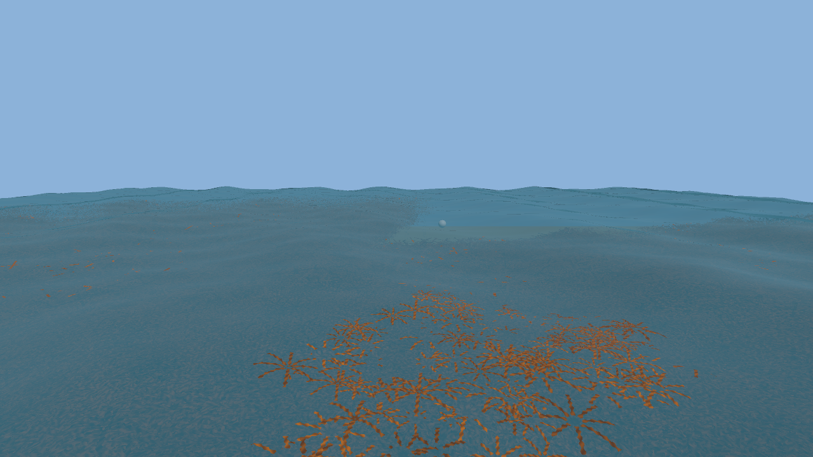 | 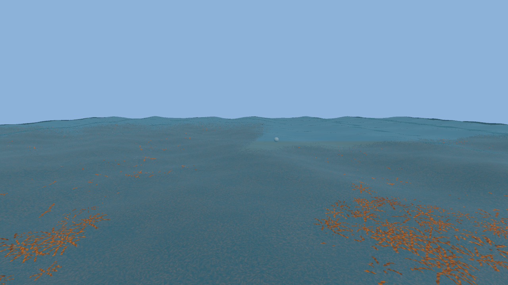 |

## 5. Zones naturelles

**Objectif :** des zones au contour naturel, sans décrire chaque détail par une longue liste de points.

**Deux approches mesurées.** Le test « ce point est-il dans la zone ? » est fait pour chaque candidat au placement (une fois), et pour chaque instance à chaque image et pour chaque caméra si *Clip To Volume* est actif.

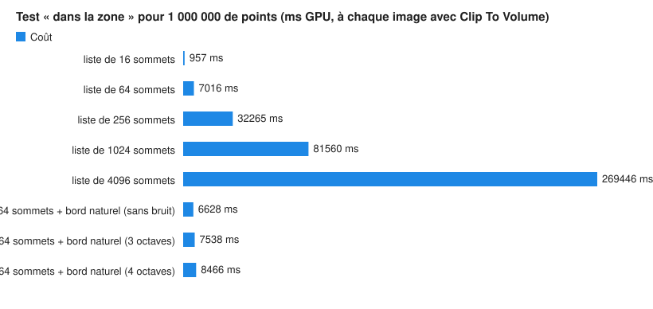

| Test pour 1 000 000 de points (GPU) | Coût |
|---|---|
| Liste de 16 sommets | 0,10 ms |
| Liste de 64 sommets | 0,70 ms |
| Liste de 256 sommets | 3,23 ms |
| Liste de 1 024 sommets | 8,16 ms |
| Liste de 4 096 sommets | 26,9 ms |
| **64 sommets + bord naturel (distance signée + bruit 3 octaves)** | **0,75 ms** |

Une liste longue coûte en proportion du nombre de sommets, à chaque image. **Choix retenu :** peu de points de contrôle, et une fonction qui rend la zone naturelle, toujours au prix d'un polygone de 64 sommets.

Les quatre réglages de la zone (*Zone : bord naturel*) :
- **Zone Smooth** : courbe qui passe par chaque point de contrôle (Catmull-Rom centripète : ni boucle ni dépassement entre des points rapprochés). Elle est découpée en 64 sommets au plus.
- **Zone Edge Noise** : le bord est déplacé de ± cette distance par un bruit fractal (3 octaves), comme une côte. Le bruit est calculé à partir du centre de la zone : il suit l'objet.
- **Zone Edge Noise Scale** : taille des irrégularités.
- **Zone Edge Feather** : lisière. Le placement s'éclaircit jusqu'à zéro sur cette distance avant le bord, au lieu d'être coupé net.

Le même calcul sert à trois endroits :
- au placement (GPU) ;
- à la destruction par le volume (GPU, sans la lisière) ;
- à `VolumeContains` (C#). Le test de fumée vérifie que le GPU et le C# sont d'accord : 0 désaccord sur 2 788 instances.

Même zone de 8 points de contrôle (en rouge), vue de dessus, à 3 instances par m² :

| Polygone (8 019 instances) | Contour courbe (8 958) |
|---|---|
| 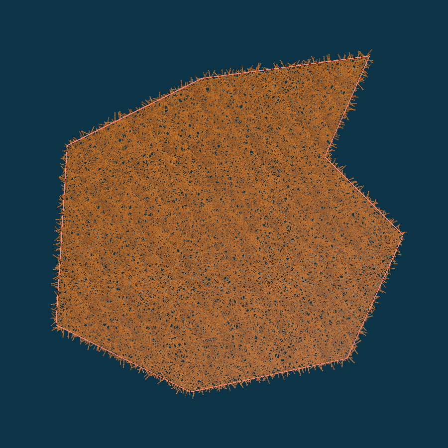 | 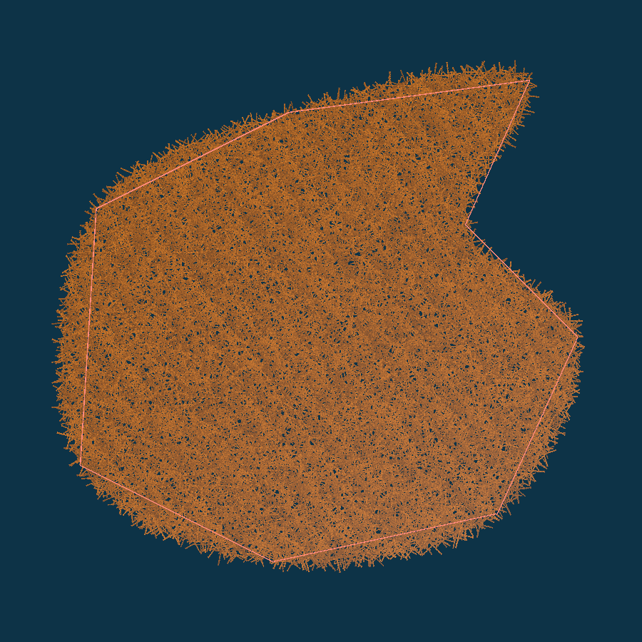 |
| **+ bord irrégulier ± 3 m, 12 m (8 998)** | **+ lisière 5 m (7 475)** |
| 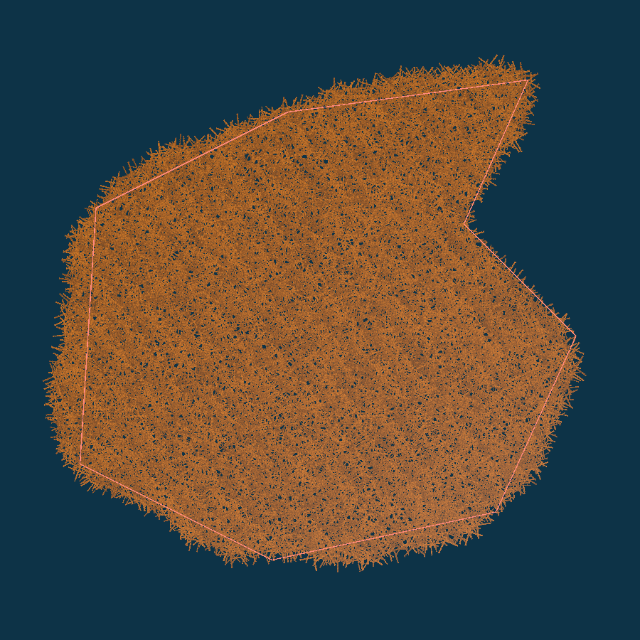 | 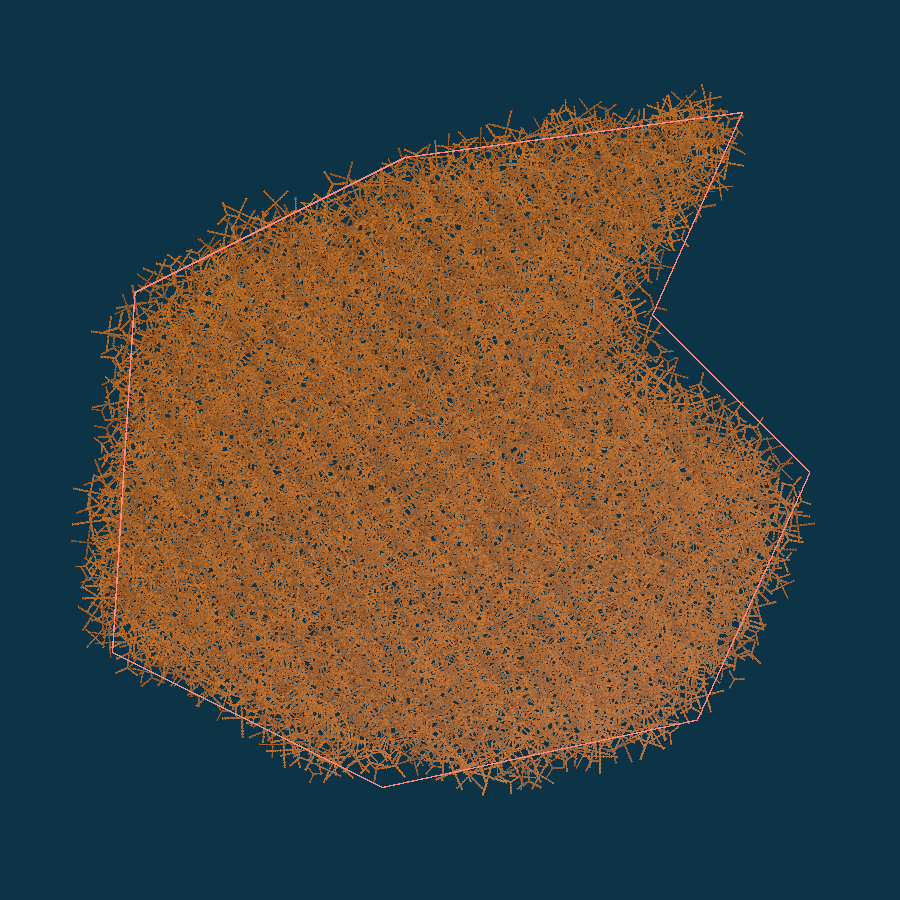 |

La courbe passe par les coins : elle bombe vers l'extérieur entre les points, d'où plus d'instances qu'avec le polygone.

**Scène de test pour comparer soi-même :** `Assets/DevTools/Scenes/ZoneNaturelleTest.unity`. On la recrée par le menu *Tools > Nyx > GPU Instancing > Dev > Scène de test : zone naturelle détaillée*. Elle contient la même côte en deux versions, au même endroit : activer l'une ou l'autre.
- **2 048 sommets** : la liste complète est visible et modifiable dans l'inspecteur (*Zone Points*). La vue Scene ne montre que le contour au-delà de 256 sommets.
- **16 points + bord naturel** : contour courbe, bord irrégulier ± 4 m et lisière 4 m, désactivée au départ.

La limite de sommets passe de 64 à 4 096 : les sommets sont maintenant envoyés au GPU dans un buffer. L'inspecteur affiche le coût estimé du test au-delà de 64 sommets.

| Scène de test, 1280 × 720 (éditeur) | 2 048 sommets (239 453 touffes) | 16 points + bord naturel (221 218 touffes) |
|---|---|---|
| Image avec *Clip To Volume* | 9,87 ms | 4,27 ms |
| Image sans *Clip To Volume* | 4,51 ms | 4,14 ms |
| **Test de la zone, à chaque image et par caméra** | **5,36 ms** | **0,13 ms** |
| Reconstruction + premier rendu (avec *Clip To Volume*) | 21,2 ms | 5,9 ms |

## 6. Mesuré sans gain, ou pas encore fait

**Sans gain mesurable :**
- dessiner les LOD0 de toutes les variantes avant les LOD1 ;
- une inverse de matrice simplifiée (transposée / échelle²) ;
- *Min Screen Size* 0,002 à 0,003 : presque aucune touffe retirée dans cette vue ;
- réutiliser le buffer intermédiaire d'envoi : abandonné avec ce chemin.

**Pistes chiffrées, non faites car elles changent l'image :**
- **Clairsemer au loin** : au-delà de 60 m, les touffes coûtent environ 2 ms (au-delà de 40 m : 3,2 ms). En n'en gardant qu'une partie, agrandie pour couvrir la même surface, on en récupérerait une part.
- **LOD1 sans normal map** : sans normal map, l'image coûte 1,1 ms de moins. Le LOD1 représente 97 % des touffes visibles, donc un matériau par LOD en garderait presque tout le gain.

**Pas encore mesuré :** l'occlusion culling, c'est-à-dire retirer les touffes cachées derrière d'autres. Il faudrait une pyramide de profondeur de l'image précédente sur GPU. Gain inconnu : les frondes alpha-testées laissent passer le regard, et la caméra regarde surtout le tapis de haut.

## Reproduire les mesures

Outils du dépôt, hors package, lancés par `Logs/NyxGpuInstancingTest/invoke.request` (voir `Assets/DevTools/Editor/NyxGpuInstancingDevTrigger.cs`) :

| Outil | Mesure |
|---|---|
| `MeshSpawnerPerfBenchmark` (`Run`) | reconstruction, rendu, culling, chemin C#, sur plusieurs cas de 640 000 à 1 000 000 d'instances |
| `DemoGpuBreakdown` (`Run`) | répartition du temps GPU de la scène ouverte, vue de sa caméra principale |
| `ProfilerSpikeReport` (`Run`, `CapturePlayMode`, `CaptureEditorPlayMode`, `RunBuildCapture`) | pics dans les images du Profiler |
| `NyxDevBuild` (`BuildDemo`) + `NyxBuildPerfProbe` (`-nyxPerfLog <dossier> -nyxCompareDepth`) | build de développement et temps par image du jeu |
| `ZoneTestCostExperiment` (`Run`) | coût GPU du test de zone : liste longue ou bord naturel |
| `OptimisationReport` (`MeasureEditor`, `Charts`) | séries, images et graphiques de ce document. L'état « avant » des sargasses utilise la copie de l'ancien shader, `Assets/DevTools/Experiments/SargassumExperiment.shader` (graine lue à chaque pixel). |
